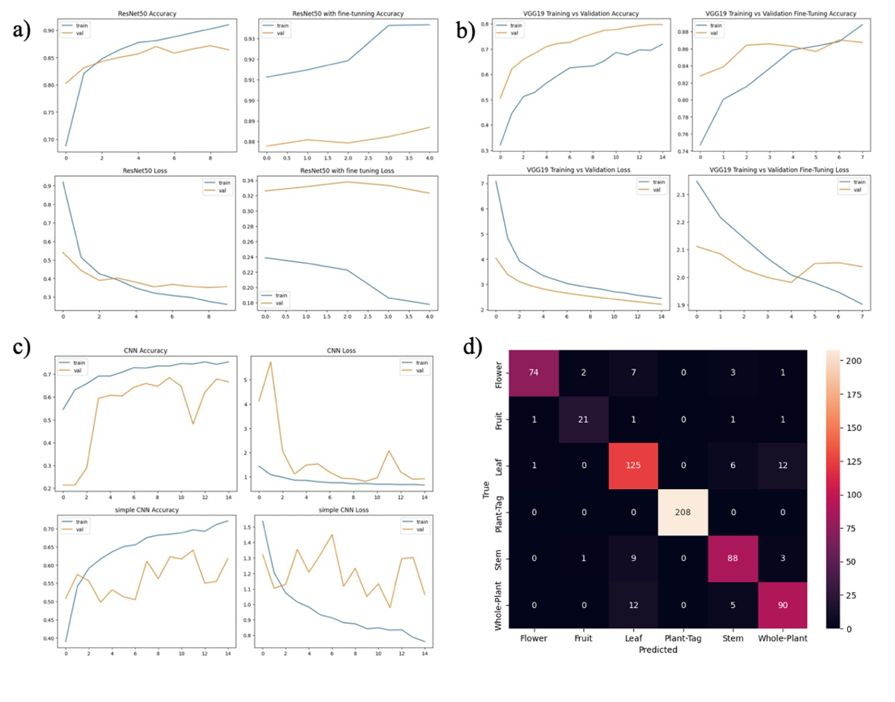
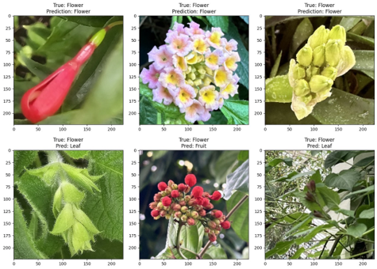

# 03-Plant-Morphology-Classification Using Deep Learning

## Overview

This project investigates the use of deep learning for automated
classification of plant morphological structures using an image
dataset from the Royal Botanic Gardens, Kew.

Four deep learning architectures were compared, ranging from
CNN models trained from scratch to transfer-learning approaches
using ImageNet-pretrained networks.

The project aimed to determine how model architecture and transfer
learning affect classification performance on botanical images.

### **Project archive:** 
This repository documents the methodology and results of the original project. The original source code is no longer
available following hardware failure, so this repository is presented as a project case study rather than a reproducible implementation.

## Objectives

- Develop a deep learning pipeline for plant morphology classification.
- Compare CNN architectures trained from scratch with transfer-learning
  approaches.
- Evaluate the effectiveness of VGG19 and ResNet50 pretrained on ImageNet.
- Investigate differences in classification performance between
  morphological classes.
- Analyse model errors and potential sources of misclassification.

## Dataset

The dataset consisted of **4,453 labelled images** from the
Royal Botanic Gardens, Kew, covering six image classes:

- Flower
- Fruit
- Leaf
- Stem
- Whole plant
- Plant tag

The data were divided using a stratified 70:15:15 split into
training, validation, and test sets.

Images were resized to 224 × 224 pixels and augmented using
transformations including random flipping, rotation, zoom,
contrast, brightness, and translation.

## Models

Four architectures were evaluated:

### Simple CNN
A baseline convolutional neural network used to establish
performance when training from scratch.

### Custom CNN
A deeper CNN incorporating batch normalization and dropout
to improve feature extraction and regularisation.

### VGG19
An ImageNet-pretrained VGG19 model adapted using transfer learning.

### ResNet50
An ImageNet-pretrained residual network adapted using transfer
learning and fine-tuning.

## Results

**Figure 1.** Model training and validation performance: (a) ResNet50,
(b) VGG19, (c) CNN architectures, and (d) ResNet50 confusion matrix.

| Model | Test Accuracy | Precision | Recall | F1-score |
|---|---:|---:|---:|---:|
| Simple CNN | 60.71% | 0.6725 | 0.6071 | 0.5692 |
| Custom CNN | 70.39% | 0.7566 | 0.7038 | 0.6803 |
| VGG19 | 88.39% | 0.8880 | 0.8839 | 0.8846 |
| **ResNet50** | **90.18%** | **0.9044** | **0.9018** | **0.9023** |

NOTE: ResNet50 achieved the strongest overall performance, reaching
90.18% test accuracy and an F1-score of 0.9023.

Both transfer-learning models substantially outperformed the CNN
architectures trained from scratch, demonstrating the effectiveness
of pretrained ImageNet features for this botanical classification task.

## Classification Analysis

Performance varied across morphological classes.

ResNet50 achieved particularly strong performance for plant tags,
while fruit remained the most challenging morphological class.

| Class | ResNet50 F1-score |
|---|---:|
| Flower | 0.91 |
| Fruit | 0.81 |
| Leaf | 0.84 |
| Stem | 0.83 |
| Whole plant | 0.83 |
| Plant tag | 1.00 |

The confusion matrix revealed meaningful errors between visually
similar botanical structures. In particular, confusion occurred
between leaves and stems and between whole-plant images and leaves.

These errors suggest that morphological similarity and background
content can influence model predictions.

## Error Analysis

**Figure 2.** Examples of successful and unsuccessful ResNet50 predictions.
The top row shows correctly classified flower images, while the bottom
row illustrates misclassifications as leaf and fruit.

Qualitative inspection showed that classification errors often occurred
when other plant structures were visually prominent within an image.
For example, flower images containing substantial foliage could be
classified as leaves, highlighting the challenge posed by overlapping
morphological features and background information.

## Limitations & Future Work

The experiments were limited to an input resolution of 224 × 224
pixels due to computational constraints. Higher-resolution images
could preserve fine morphological details that may be lost during
resizing.

Potential future work includes:

- Evaluating higher-resolution image inputs.
- Further fine-tuning of transfer-learning architectures.
- Expanding underrepresented morphology classes.
- Investigating class-specific augmentation strategies.
- Improving image collection to reduce background noise and
  morphological overlap.
